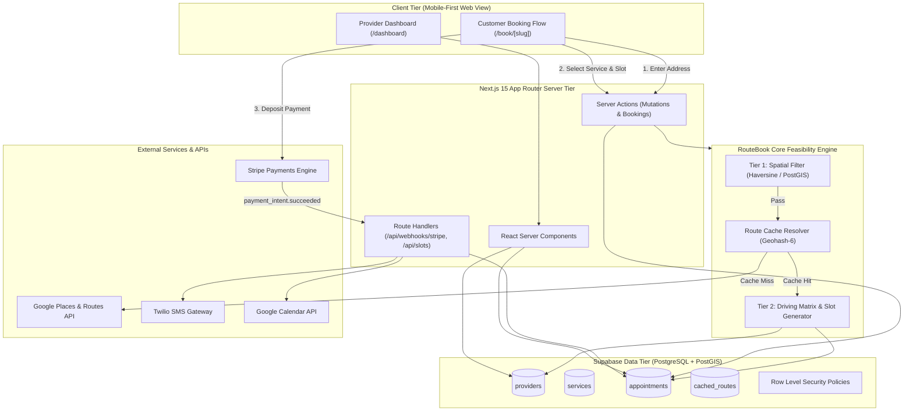
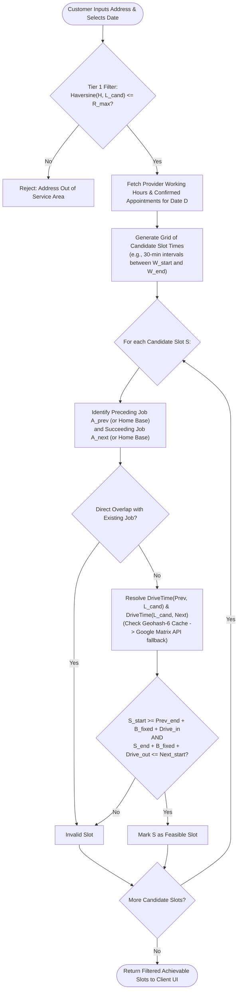
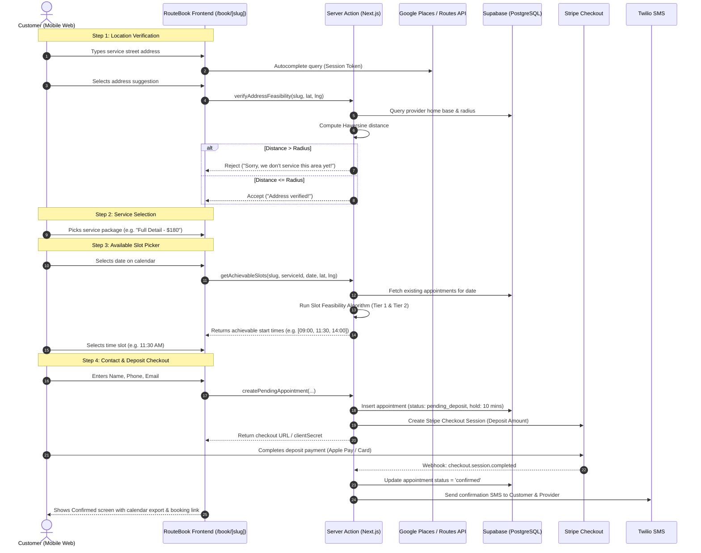
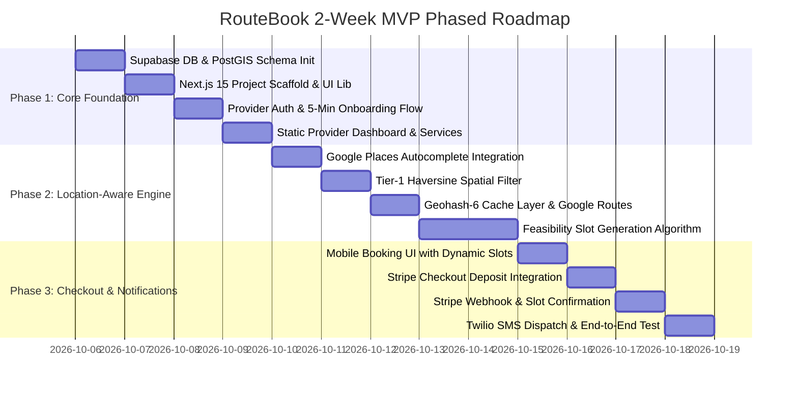

# RouteBook: System Architecture & Technical Specification

> **Version:** 1.0.0-PROD-SPEC  
> **Status:** APPROVED FOR BUILD  
> **Target Audience:** Lead Full-Stack Engineers, System Architects, DevOps  

---

## 1. Executive Summary & System Architecture

### 1.1 Problem Statement & Solution Overview
Traditional service booking tools (Calendly, Acuity, Square Appointments) are fundamentally **location-blind**. They treat provider availability as static calendar blocks. For mobile service providers (mobile auto detailers, mobile pet groomers, mobile mechanics), a 2:00 PM opening is meaningless if the previous appointment ends at 1:45 PM on the opposite side of a metropolitan area. 

**RouteBook** resolves this by operating as a **location-aware booking engine**. It treats travel time as a dynamic first-class constraint:
1. Customers provide their exact service address **before** seeing calendar availability.
2. The engine filters availability using a two-tier spatial & temporal model:
   - **Tier 1 (Instant):** In-memory / database Haversine radius check against the provider's base location.
   - **Tier 2 (Precise):** Route computation (Distance Matrix with spatial geohash caching) measuring drive time from the preceding appointment (or home base) and drive time to the succeeding appointment (or home base).
3. The customer is presented with only **genuinely achievable** time windows.

---

### 1.2 Technology Stack

| Layer | Technology | Rationale & Architectural Role |
| :--- | :--- | :--- |
| **Framework** | **Next.js 15+ (App Router)** | React Server Components (RSC) for zero-bundle payload reads, Server Actions for transactional mutations, Edge & Node.js runtimes. |
| **Language** | **TypeScript 5.5+** | Strict null checks, shared DTO interfaces between server and client, end-to-end type safety. |
| **Styling & UI** | **Tailwind CSS + shadcn/ui** | Lightweight, utility-first design, mobile-first responsive layout optimized for Instagram bio / mobile browser views. |
| **Database & Auth** | **Supabase (PostgreSQL 16 + PostGIS)** | Native geospatial queries (`geography(Point, 4326)`), Row Level Security (RLS), Supabase Auth (email/magic link/OAuth), Database Triggers. |
| **Mapping & Routing** | **Google Maps Platform** | **Places API (New):** Address Autocomplete with Session Tokens to minimize cost.<br>**Routes API / Distance Matrix API:** High-accuracy driving duration. |
| **Route Caching** | **PostgreSQL / Geohash-6 Cache** | Custom persistent routing cache table using Geohash-6 pairs (~1.2 km precision) to eliminate up to 85% of redundant Google Distance Matrix API calls. |
| **Payments** | **Stripe (Elements & Connect)** | Stripe Checkout / PaymentIntents for deposit capture, Stripe Connect Express for provider payouts. |
| **Messaging** | **Twilio Messaging API** | Automated SMS dispatch for booking confirmations, reminders, and schedule updates. |
| **Calendar Sync** | **Google Calendar API (OAuth2)** | Two-way conflict avoidance and calendar event generation. |

---

### 1.3 High-Level System Architecture Diagram



---

### 1.4 Google Maps API Cost Optimization Strategy
Google Distance Matrix and Routes APIs charge per element ($0.005 to $0.010 per element). Unmitigated, loading a monthly calendar with 30 days and 8 potential slots per day could trigger hundreds of matrix calls per customer visit, rapidly destroying Micro SaaS margins.

We apply a **three-layer defensive strategy**:

1. **Places Autocomplete Session Tokens:**
   - Group the autocomplete keystrokes and final Place Details request under a single `sessionToken`.
   - Bill is capped at $0.017 per session rather than per keystroke.
2. **Tier-1 Spatial Pre-Filter (Zero API Cost):**
   - As soon as the customer's coordinates $(lat, lng)$ are obtained, execute an immediate Haversine distance calculation against the provider's base location.
   - If distance $> R_{service\_radius}$, reject immediately before invoking any routing engine.
3. **Geohash-6 Clustered Route Caching:**
   - Real-world traffic travel times between two neighborhoods do not vary significantly down to the meter for booking buffers.
   - We convert origin and destination coordinates into **Geohash-6** strings (bounding boxes of approximately $1.2\text{ km} \times 0.6\text{ km}$).
   - Store results in `cached_routes` with a 30-day TTL (or hour-of-day bucketing if peak rush hour logic is enabled).
   - Only cache misses invoke the Google Routes API.

---

## 2. Core Algorithm Specification: Dynamic Time Slot Feasibility

### 2.1 Problem Formulation & Variables

Let the provider's operating parameters for target date $D$ be defined as:
- **Home Base Coordinates:** $H = (lat_H, lng_H)$
- **Service Radius:** $R_{max}$ (in miles)
- **Working Hours Window:** $[W_{start}, W_{end}]$ (e.g., 08:00 to 18:00)
- **Fixed Turnaround / Clean-up Buffer:** $B_{fixed}$ (e.g., 15 minutes for cleaning equipment)
- **Candidate Customer Service Location:** $L_{cand} = (lat_C, lng_C)$
- **Requested Service Duration:** $T_{service}$ (in minutes)

Let the existing confirmed appointments on date $D$ sorted chronologically by start time be:
$$\mathcal{A} = [A_1, A_2, \dots, A_n]$$
Where each appointment $A_i$ has:
- Start time $A_{i, start}$
- End time $A_{i, end} = A_{i, start} + Duration(A_i)$
- Service location $L_{A_i} = (lat_{A_i}, lng_{A_i})$

Let the driving duration function between two locations $L_1$ and $L_2$ be:
$$DriveTime(L_1, L_2) \ge 0 \quad \text{(in minutes)}$$

---

### 2.2 Feasibility Criteria for a Candidate Slot $S = [S_{start}, S_{end}]$
Where $S_{end} = S_{start} + T_{service}$.

A candidate time slot $S$ starting at $S_{start}$ on date $D$ is **feasible** if and only if all of the following conditions hold:

#### Condition 1: Provider Working Hours Bound
$$S_{start} \ge W_{start} + DriveTime(H, L_{cand})$$
$$S_{end} + B_{fixed} + (ReturnToBaseRequired \ ? \ DriveTime(L_{cand}, H) : 0) \le W_{end}$$

#### Condition 2: Preceding Appointment Buffer Feasibility
If $S$ is scheduled after appointment $A_i$:
$$S_{start} \ge A_{i, end} + B_{fixed} + DriveTime(L_{A_i}, L_{cand})$$

#### Condition 3: Succeeding Appointment Buffer Feasibility
If $S$ is scheduled before appointment $A_{i+1}$:
$$S_{end} + B_{fixed} + DriveTime(L_{cand}, L_{A_{i+1}}) \le A_{i+1, start}$$

#### Condition 4: No Overlap with Any Existing Appointment
$$\forall A_k \in \mathcal{A}: [S_{start}, S_{end}] \cap [A_{k, start}, A_{k, end}] = \emptyset$$

---

### 2.3 Two-Tier Feasibility Architecture



---

### 2.4 Tier-1 Spatial Filter: Haversine Formula

The great-circle distance $d$ between base $H = (\phi_1, \lambda_1)$ and candidate $L_{cand} = (\phi_2, \lambda_2)$ in miles:

$$\Delta \phi = \frac{\pi}{180}(\phi_2 - \phi_1), \quad \Delta \lambda = \frac{\pi}{180}(\lambda_2 - \lambda_1)$$
$$a = \sin^2\left(\frac{\Delta \phi}{2}\right) + \cos\left(\frac{\pi}{180}\phi_1\right)\cos\left(\frac{\pi}{180}\phi_2\right)\sin^2\left(\frac{\Delta \lambda}{2}\right)$$
$$c = 2 \cdot \text{atan2}\left(\sqrt{a}, \sqrt{1 - a}\right)$$
$$d = R_{\text{earth}} \cdot c \quad \text{where } R_{\text{earth}} \approx 3958.8\text{ miles}$$

If $d > R_{max}$, immediately abort and notify the user that their location is outside the operational boundary.

---

### 2.5 Tier-2 Route Cache Specification (Geohash-6)

Geohash encodes latitude and longitude into a base-32 string.
- Length 5: $\approx 4.9\text{ km} \times 4.9\text{ km}$ (Too coarse for drive times).
- Length 6: $\approx 1.2\text{ km} \times 0.61\text{ km}$ (**Optimal sweet spot** for metropolitan drive time clustering).
- Length 7: $\approx 150\text{ m} \times 150\text{ m}$ (Too specific, low cache hit rate).

#### Cache Lookup Logic
```typescript
interface RouteResult {
  durationMinutes: number;
  distanceMiles: number;
}

async function getTravelTime(
  origin: { lat: number; lng: number },
  dest: { lat: number; lng: number }
): Promise<RouteResult> {
  const originGeohash = encodeGeohash(origin.lat, origin.lng, 6);
  const destGeohash = encodeGeohash(dest.lat, dest.lng, 6);

  if (originGeohash === destGeohash) {
    // Same immediate neighborhood: default nominal drive buffer
    return { durationMinutes: 5, distanceMiles: 0.5 };
  }

  // 1. Query Supabase cached_routes
  const cached = await db.cached_routes.findFirst({
    where: {
      origin_geohash: originGeohash,
      dest_geohash: destGeohash,
      expires_at: { gt: new Date() }
    }
  });

  if (cached) {
    return {
      durationMinutes: Math.ceil(cached.duration_seconds / 60),
      distanceMiles: cached.distance_meters * 0.000621371
    };
  }

  // 2. Fetch from Google Routes API
  const computed = await callGoogleRoutesAPI(origin, dest);

  // 3. Persist to cache (TTL = 30 days)
  await db.cached_routes.upsert({
    origin_geohash: originGeohash,
    dest_geohash: destGeohash,
    duration_seconds: computed.durationSeconds,
    distance_meters: computed.distanceMeters,
    expires_at: new Date(Date.now() + 30 * 24 * 60 * 60 * 1000)
  });

  return {
    durationMinutes: Math.ceil(computed.durationSeconds / 60),
    distanceMiles: computed.distanceMeters * 0.000621371
  };
}
```

---

### 2.6 Edge Cases & Mitigation Strategies

| Edge Case | Description | Mitigation Strategy |
| :--- | :--- | :--- |
| **Zero-Appointment Day** | No existing appointments on the target date. | Feasibility reduces solely to checking Home Base bounds: $S_{start} \ge W_{start} + DriveTime(H, L_{cand})$ and $S_{end} + DriveTime(L_{cand}, H) \le W_{end}$. |
| **Back-to-Back Neighbors** | Customer booking at an address $< 0.5$ miles from previous job. | Geohash match sets nominal drive time (e.g., 5 mins). No Google API calls incurred. |
| **Rush Hour Variance** | Travel time between 4 PM and 6 PM is $1.5\times$ longer. | Apply dynamic rush hour coefficient ($1.25\times$ base travel duration) when transit occurs between 07:30–09:30 or 16:30–18:30. |
| **Provider Mid-Day Breaks** | Provider reserves 12:00 PM – 1:00 PM for lunch. | Lunch block is injected into the $\mathcal{A}$ list as a fixed pseudo-appointment with location set to the previous job or provider base. |
| **Concurrency / Slot Race** | Two clients attempt booking the same slot simultaneously. | Optimistic UI locking with a 10-minute hold status in DB (`pending_deposit`), backed by PostgreSQL atomic transaction. |

---

## 3. Supabase Database Schema (PostgreSQL DDL)

The complete SQL DDL schema incorporates spatial indexing, Row Level Security, JSONB validation, and automated timestamp management.

```sql
-- ============================================================================
-- ROUTEBOOK DATABASE SCHEMA
-- Extensions: PostGIS for geospatial analysis, pgcrypto for UUID generation
-- ============================================================================

CREATE EXTENSION IF NOT EXISTS "uuid-ossp";
CREATE EXTENSION IF NOT EXISTS "postgis";

-- ----------------------------------------------------------------------------
-- 1. ENUMS
-- ----------------------------------------------------------------------------
CREATE TYPE appointment_status AS ENUM (
    'pending_deposit',
    'confirmed',
    'in_progress',
    'completed',
    'cancelled',
    'refunded'
);

CREATE TYPE payment_status AS ENUM (
    'unpaid',
    'deposit_paid',
    'fully_paid',
    'refunded'
);

-- ----------------------------------------------------------------------------
-- 2. TABLE: profiles / providers
-- Represents the mobile service business owner
-- ----------------------------------------------------------------------------
CREATE TABLE public.providers (
    id UUID PRIMARY KEY REFERENCES auth.users(id) ON DELETE CASCADE,
    slug TEXT UNIQUE NOT NULL,
    business_name TEXT NOT NULL,
    owner_name TEXT NOT NULL,
    phone TEXT NOT NULL,
    email TEXT NOT NULL,
    
    -- Home base location for route calculation start/end of day
    base_address TEXT NOT NULL,
    base_location GEOGRAPHY(Point, 4326) NOT NULL,
    base_lat DOUBLE PRECISION NOT NULL,
    base_lng DOUBLE PRECISION NOT NULL,
    
    -- Service bounds
    service_radius_miles NUMERIC(5,2) NOT NULL DEFAULT 20.00,
    fixed_buffer_minutes INTEGER NOT NULL DEFAULT 15,
    return_to_base_required BOOLEAN NOT NULL DEFAULT TRUE,
    
    -- Weekly operational hours:
    -- Example structure:
    -- {
    --   "monday":    {"active": true, "start": "08:00", "end": "17:00", "breaks": []},
    --   "tuesday":   {"active": true, "start": "08:00", "end": "17:00", "breaks": []},
    --   "wednesday": {"active": true, "start": "08:00", "end": "17:00", "breaks": []},
    --   "thursday":  {"active": true, "start": "08:00", "end": "17:00", "breaks": []},
    --   "friday":    {"active": true, "start": "08:00", "end": "17:00", "breaks": []},
    --   "saturday":  {"active": false, "start": "09:00", "end": "14:00", "breaks": []},
    --   "sunday":    {"active": false, "start": "09:00", "end": "14:00", "breaks": []}
    -- }
    working_hours JSONB NOT NULL DEFAULT '{
        "monday":    {"active": true, "start": "08:00", "end": "17:00", "breaks": []},
        "tuesday":   {"active": true, "start": "08:00", "end": "17:00", "breaks": []},
        "wednesday": {"active": true, "start": "08:00", "end": "17:00", "breaks": []},
        "thursday":  {"active": true, "start": "08:00", "end": "17:00", "breaks": []},
        "friday":    {"active": true, "start": "08:00", "end": "17:00", "breaks": []},
        "saturday":  {"active": false, "start": "09:00", "end": "14:00", "breaks": []},
        "sunday":    {"active": false, "start": "09:00", "end": "14:00", "breaks": []}
    }'::jsonb,

    -- Integrations
    stripe_account_id TEXT,
    stripe_charges_enabled BOOLEAN NOT NULL DEFAULT FALSE,
    google_calendar_token JSONB,
    google_calendar_id TEXT,

    created_at TIMESTAMPTZ NOT NULL DEFAULT TIMEZONE('utc', NOW()),
    updated_at TIMESTAMPTZ NOT NULL DEFAULT TIMEZONE('utc', NOW())
);

-- Index slug for high-speed public page resolution
CREATE INDEX idx_providers_slug ON public.providers(slug);
CREATE INDEX idx_providers_base_location ON public.providers USING GIST(base_location);

-- ----------------------------------------------------------------------------
-- 3. TABLE: services
-- Services offered by the mobile operator
-- ----------------------------------------------------------------------------
CREATE TABLE public.services (
    id UUID PRIMARY KEY DEFAULT uuid_generate_v4(),
    provider_id UUID NOT NULL REFERENCES public.providers(id) ON DELETE CASCADE,
    title TEXT NOT NULL,
    description TEXT,
    duration_minutes INTEGER NOT NULL CHECK (duration_minutes > 0),
    price_cents INTEGER NOT NULL CHECK (price_cents >= 0),
    deposit_amount_cents INTEGER NOT NULL DEFAULT 0 CHECK (deposit_amount_cents >= 0),
    is_active BOOLEAN NOT NULL DEFAULT TRUE,
    sort_order INTEGER NOT NULL DEFAULT 0,
    
    created_at TIMESTAMPTZ NOT NULL DEFAULT TIMEZONE('utc', NOW()),
    updated_at TIMESTAMPTZ NOT NULL DEFAULT TIMEZONE('utc', NOW())
);

CREATE INDEX idx_services_provider ON public.services(provider_id) WHERE is_active = TRUE;

-- ----------------------------------------------------------------------------
-- 4. TABLE: appointments
-- Booked jobs with precise spatial and temporal data
-- ----------------------------------------------------------------------------
CREATE TABLE public.appointments (
    id UUID PRIMARY KEY DEFAULT uuid_generate_v4(),
    provider_id UUID NOT NULL REFERENCES public.providers(id) ON DELETE CASCADE,
    service_id UUID NOT NULL REFERENCES public.services(id) ON DELETE RESTRICT,
    
    -- Customer Identity
    customer_name TEXT NOT NULL,
    customer_email TEXT NOT NULL,
    customer_phone TEXT NOT NULL,
    
    -- Service Location
    service_address TEXT NOT NULL,
    location GEOGRAPHY(Point, 4326) NOT NULL,
    lat DOUBLE PRECISION NOT NULL,
    lng DOUBLE PRECISION NOT NULL,
    
    -- Appointment Timing
    start_time TIMESTAMPTZ NOT NULL,
    end_time TIMESTAMPTZ NOT NULL,
    
    -- Buffer & Routing diagnostics saved at creation
    travel_time_from_prev_mins INTEGER NOT NULL DEFAULT 0,
    travel_time_to_next_mins INTEGER NOT NULL DEFAULT 0,
    
    -- Status & Payments
    status appointment_status NOT NULL DEFAULT 'pending_deposit',
    payment_status payment_status NOT NULL DEFAULT 'unpaid',
    stripe_payment_intent_id TEXT,
    stripe_checkout_session_id TEXT,
    deposit_amount_paid_cents INTEGER NOT NULL DEFAULT 0,
    
    -- Metadata & Notes
    customer_notes TEXT,
    internal_notes TEXT,
    cancellation_reason TEXT,
    
    -- Reservation Hold Expiry (for pending_deposit slots)
    hold_expires_at TIMESTAMPTZ,
    
    created_at TIMESTAMPTZ NOT NULL DEFAULT TIMEZONE('utc', NOW()),
    updated_at TIMESTAMPTZ NOT NULL DEFAULT TIMEZONE('utc', NOW()),

    CONSTRAINT check_end_after_start CHECK (end_time > start_time)
);

-- Indexes for slot collision calculation and calendar queries
CREATE INDEX idx_appointments_provider_date_range ON public.appointments(provider_id, start_time, end_time) 
    WHERE status NOT IN ('cancelled');
CREATE INDEX idx_appointments_location ON public.appointments USING GIST(location);
CREATE INDEX idx_appointments_status ON public.appointments(status);
CREATE INDEX idx_appointments_hold_expiry ON public.appointments(hold_expires_at) 
    WHERE status = 'pending_deposit';

-- ----------------------------------------------------------------------------
-- 5. TABLE: cached_routes
-- Persistent route matrix cache between Geohash-6 clusters
-- ----------------------------------------------------------------------------
CREATE TABLE public.cached_routes (
    id UUID PRIMARY KEY DEFAULT uuid_generate_v4(),
    origin_geohash VARCHAR(12) NOT NULL,
    dest_geohash VARCHAR(12) NOT NULL,
    duration_seconds INTEGER NOT NULL,
    distance_meters INTEGER NOT NULL,
    expires_at TIMESTAMPTZ NOT NULL,
    created_at TIMESTAMPTZ NOT NULL DEFAULT TIMEZONE('utc', NOW()),
    
    CONSTRAINT uq_route_pair UNIQUE (origin_geohash, dest_geohash)
);

CREATE INDEX idx_cached_routes_lookup ON public.cached_routes(origin_geohash, dest_geohash);
CREATE INDEX idx_cached_routes_expiry ON public.cached_routes(expires_at);

-- ----------------------------------------------------------------------------
-- 6. AUTOMATED UPDATED_AT TRIGGER
-- ----------------------------------------------------------------------------
CREATE OR REPLACE FUNCTION update_updated_at_column()
RETURNS TRIGGER AS $$
BEGIN
    NEW.updated_at = TIMEZONE('utc', NOW());
    RETURN NEW;
END;
$$ LANGUAGE plpgsql;

CREATE TRIGGER trg_providers_updated_at BEFORE UPDATE ON public.providers
    FOR EACH ROW EXECUTE FUNCTION update_updated_at_column();

CREATE TRIGGER trg_services_updated_at BEFORE UPDATE ON public.services
    FOR EACH ROW EXECUTE FUNCTION update_updated_at_column();

CREATE TRIGGER trg_appointments_updated_at BEFORE UPDATE ON public.appointments
    FOR EACH ROW EXECUTE FUNCTION update_updated_at_column();

-- ----------------------------------------------------------------------------
-- 7. ROW LEVEL SECURITY (RLS) POLICIES
-- ----------------------------------------------------------------------------
ALTER TABLE public.providers ENABLE ROW LEVEL SECURITY;
ALTER TABLE public.services ENABLE ROW LEVEL SECURITY;
ALTER TABLE public.appointments ENABLE ROW LEVEL SECURITY;
ALTER TABLE public.cached_routes ENABLE ROW LEVEL SECURITY;

-- PROVIDERS POLICIES
-- Anyone can view basic business profile information to book
CREATE POLICY "Public providers profile read" 
    ON public.providers FOR SELECT 
    USING (true);

-- Authenticated provider can update only their own profile
CREATE POLICY "Provider self update" 
    ON public.providers FOR UPDATE 
    TO authenticated 
    USING (auth.uid() = id) 
    WITH CHECK (auth.uid() = id);

-- Authenticated provider can insert their profile upon onboarding
CREATE POLICY "Provider self insert" 
    ON public.providers FOR INSERT 
    TO authenticated 
    WITH CHECK (auth.uid() = id);

-- SERVICES POLICIES
-- Public can view active services
CREATE POLICY "Public services read" 
    ON public.services FOR SELECT 
    USING (is_active = true);

-- Provider full access to their own services
CREATE POLICY "Provider manage services" 
    ON public.services FOR ALL 
    TO authenticated 
    USING (auth.uid() = provider_id) 
    WITH CHECK (auth.uid() = provider_id);

-- APPOINTMENTS POLICIES
-- Provider has full CRUD on appointments for their business
CREATE POLICY "Provider manage appointments" 
    ON public.appointments FOR ALL 
    TO authenticated 
    USING (auth.uid() = provider_id) 
    WITH CHECK (auth.uid() = provider_id);

-- Unauthenticated/Public client can insert a pending appointment
CREATE POLICY "Public client create pending appointment" 
    ON public.appointments FOR INSERT 
    TO anon, authenticated 
    WITH CHECK (status = 'pending_deposit');

-- Public client can view their specific appointment via appointment ID
CREATE POLICY "Client read appointment by id" 
    ON public.appointments FOR SELECT 
    TO anon, authenticated 
    USING (true);

-- CACHED ROUTES POLICIES
-- Shared cache: Read accessible by anon and authenticated for slot generation
CREATE POLICY "Public read cached routes" 
    ON public.cached_routes FOR SELECT 
    TO anon, authenticated 
    USING (expires_at > TIMEZONE('utc', NOW()));

-- Insertion into cached_routes allowed by service-role or backend server actions
CREATE POLICY "Server insert cached routes" 
    ON public.cached_routes FOR INSERT 
    TO anon, authenticated 
    WITH CHECK (true);
```

---

## 4. Public Booking Flow & UX Specification

### 4.1 Target Persona & Device Profile
- **Primary Customer Persona:** Vehicle owners or pet parents booking directly from an Instagram bio, TikTok profile, SMS link, or Google Maps Business link.
- **Primary Viewport:** Mobile Safari / Chrome on iOS & Android (375px to 430px wide).
- **Session Duration Goal:** Under 45 seconds from link click to confirmed booking.
- **Cognitive Load Minimization:** Single-column stepped flow with zero unnecessary text entry; heavy utilization of native mobile pickers, Apple Pay, and Google Pay.

---

### 4.2 Customer Booking Flow (Step-by-Step)



---

### 4.3 UI/UX Step Specifications

#### Step 1: Address Input & Eligibility Check
- **Component:** Full-screen modal or Hero card containing a prominent address input field.
- **UX Mechanism:**
  - Integrated with `@react-google-maps/api` or custom Google Places Autocomplete dropdown.
  - As soon as the user selects a place result, fetch Place Details `geometry.location`.
  - Display immediate feedback:
    - **Success State:** High-contrast green badge: *"Great news! We service your neighborhood."*
    - **Failure State:** Clear red warning badge: *"We currently only service within 20 miles of [City]. Your address is 27 miles away."* with an optional email waitlist capture.

#### Step 2: Service Selection
- **Component:** Clean vertical card deck.
- **Card Contents:**
  - Service Title (e.g., "Full Ceramic Mobile Detail").
  - Duration Pill (e.g., "⏱ 2.5 hours").
  - Price & Deposit Notice (e.g., "$220 • $50 deposit required to reserve").
  - Bulleted inclusions.

#### Step 3: Date & Dynamic Time Slot Picker
- **Component:** Horizontal scrollable date pill picker followed by dynamic time buttons.
- **Dynamic Calculation Feedback:**
  - When a date is selected, a subtle skeleton loader displays: *"Calculating optimal driving route..."*
  - Only time slots that pass the feasibility checks are rendered.
  - Slots with optimal routing (e.g., within 10 minutes of preceding job) can feature a badge: *"🌱 Eco-Friendly / Closest Route"*.

#### Step 4: Customer Details & Deposit Hold
- **Component:** Minimal form:
  - First & Last Name
  - Mobile Phone (with auto-formatting `(xxx) xxx-xxxx`)
  - Email (for calendar invite)
  - Vehicle / Pet Details (optional textarea, e.g., "2023 Tesla Model Y, white")
- **Hold Lock:** Once user reaches checkout, slot is locked for 10 minutes. If payment fails or is abandoned, cron/webhook releases the slot.

#### Step 5: Checkout & Post-Booking Confirmation
- **Checkout:** Stripe Elements embedded directly on page (or redirect to Stripe Checkout) supporting Apple Pay, Google Pay, and Link for 1-tap checkout.
- **Confirmation Screen:**
  - Clean checkmark animation.
  - Summary: Service, Date, Time, Address.
  - Direct "Add to Apple Calendar / Google Calendar" buttons (.ics export).
  - Immediate Twilio SMS dispatch: *"Hi [Name]! Your appointment with [Business] is confirmed for [Date] at [Time]. See details: [Link]"*.

---

### 4.4 Provider Onboarding (5-Minute Setup Flow)

Designed to let a mobile detailer or groomer set up their business from an iPhone while parked in their van:

1. **Step 1: Account Creation & URL Claim**
   - Sign up with Email / Google OAuth.
   - Claim custom URL slug: `routebook.me/[business-slug]`.
2. **Step 2: Base Location & Service Area**
   - Address search for home/garage base.
   - Interactive slider for Service Radius (e.g., 5 to 50 miles, default 20 miles).
   - Visual radius circle drawn on Google Maps preview.
3. **Step 3: Operating Schedule & Buffers**
   - Day toggles (Monday through Sunday).
   - Daily start and end times (e.g., 8:00 AM – 5:00 PM).
   - Clean-up/Buffer slider (e.g., 10, 15, 20, 30 minutes).
4. **Step 4: Add Services**
   - Add first 2-3 services (Title, Duration, Price, Deposit).
5. **Step 5: Stripe Connect & Launch**
   - Connect Stripe account via Stripe Connect Express onboarding for instant payouts.
   - Copy link to Instagram Bio / Google Business Profile.

---

## 5. 2-Week MVP Phased Implementation Roadmap



---

### Phase 1: Foundation, Data Layer & Provider Setup (Days 1 – 4)
*Goal: Establish database, authentication, provider onboarding, and business profile management.*

- **Day 1: Supabase Setup & PostGIS Initialization**
  - Initialize Supabase project.
  - Execute complete DDL: `providers`, `services`, `appointments`, `cached_routes`.
  - Enable PostGIS and configure RLS policies.
  - Setup TypeScript database type generation (`supabase gen types typescript`).

- **Day 2: Next.js 15 Application Scaffold**
  - Scaffold Next.js 15 App Router project with TypeScript and Tailwind CSS.
  - Install shadcn/ui components (`button`, `card`, `input`, `calendar`, `dialog`, `badge`, `tabs`).
  - Configure Supabase SSR client (`@supabase/ssr`) for Server Components and Server Actions.

- **Day 3: Provider Authentication & 5-Minute Onboarding**
  - Implement Supabase Auth (Magic Link + Google OAuth).
  - Build onboarding wizard (`/onboarding`): Business details, home base address geocoding, radius slider.
  - Slug uniqueness validation server action.

- **Day 4: Services Management & Dashboard Shell**
  - Build provider settings dashboard (`/dashboard`):
    - CRUD for services (title, duration, price, deposit).
    - Working hours configuration editor (day toggles, time pickers).
    - Base buffer setting.

---

### Phase 2: Location-Aware Feasibility Engine (Days 5 – 9)
*Goal: Implement the core differentiator—spatial filtering, route caching, and dynamic achievable time slot computation.*

- **Day 5: Google Places Autocomplete & Tier-1 Spatial Filter**
  - Setup Google Maps Platform API credentials.
  - Implement Places Autocomplete client component with session token preservation.
  - Build `verifyAddressFeasibility` Server Action: PostGIS / Haversine distance verification against provider base radius.

- **Day 6: Geohash-6 Route Cache Engine**
  - Implement Geohash-6 utility functions (encode / decode).
  - Build route lookup resolver:
    - Check `cached_routes` table in Supabase.
    - Call Google Routes API on cache miss.
    - Write result with 30-day TTL.

- **Day 7 – 8: Core Dynamic Slot Generation Algorithm**
  - Implement `calculateAchievableSlots` Server Action:
    - Fetch provider working hours and non-cancelled appointments for date.
    - Generate candidate slot intervals (e.g., 30-min increments).
    - Compute driving buffers to previous and next scheduled appointments.
    - Validate feasibility conditions (working bounds, transit buffers, zero overlap).
  - Unit test suite for algorithm edge cases:
    - Empty schedule day.
    - Fully booked day.
    - Booking adjacent to home base vs. booking across town.
    - Consecutive appointment at nearby address.

- **Day 9: Dynamic Time Slot Frontend Integration**
  - Connect mobile slot picker to `calculateAchievableSlots`.
  - Loading skeletons and optimized optimistic UX.

---

### Phase 3: Stripe Checkout, SMS Dispatch & Polish (Days 10 – 14)
*Goal: Complete the transactional loop—payment deposits, reservation locking, Twilio SMS, and mobile view polish.*

- **Day 10: Reservation Hold & Stripe Integration**
  - Implement slot hold mechanism (`hold_expires_at` with 10-minute timeout).
  - Configure Stripe Connect / Stripe Checkout.
  - Create checkout session server action for deposit amounts.

- **Day 11: Stripe Webhook Handling & State Machine**
  - Build `/api/webhooks/stripe` route handler:
    - Handle `checkout.session.completed` / `payment_intent.succeeded`.
    - Transition appointment from `pending_deposit` to `confirmed`.
    - Handle payment failure / expiry cleanup.

- **Day 12: Twilio SMS Notification Service**
  - Setup Twilio messaging client.
  - Dispatch automated booking confirmation SMS to customer with appointment summary and cancel/reschedule link.
  - Dispatch SMS notification to provider with customer address and navigation link (Google Maps pin).

- **Day 13: End-to-End Testing & Mobile View Optimization**
  - Test booking flow on real mobile devices (iOS Safari & Android Chrome).
  - Verify layout responsiveness on 375px screens.
  - Audit Google Maps API consumption and confirm cache hit rates.

- **Day 14: Production Deployment & Verification**
  - Deploy to Vercel with production environment variables.
  - Run smoke tests against production Supabase, Stripe test mode, and Twilio sandbox.
  - Final documentation handoff.

---

## 6. Verification Plan & Testing Criteria

### 6.1 Feasibility Algorithm Unit Tests
1. **Test Case A: First Job of Day**
   - Shift starts 08:00 AM.
   - Drive time from Base to Job is 35 mins.
   - Assert: Slots prior to 08:35 AM are marked **unavailable**. Slot at 08:45 AM is **available**.
2. **Test Case B: Middle Job Drive Gap**
   - Job 1 ends at 11:00 AM at Location X.
   - Job 2 starts at 02:00 PM at Location Y.
   - Candidate Job duration: 60 mins.
   - Drive from X to Candidate: 25 mins.
   - Drive from Candidate to Y: 30 mins.
   - Fixed buffer: 15 mins.
   - Minimum required window: $25 + 60 + 15 + 30 = 130\text{ mins}$ (2 hrs 10 mins).
   - Assert: Slot starting at 11:45 AM completes at 12:45 PM; travel to Job 2 takes 30 mins ($12:45 + 15\text{ buffer} + 30\text{ drive} = 13:30 \le 14:00$). Slot is **available**.
   - Assert: Slot starting at 12:30 PM completes at 01:30 PM ($01:30 + 15 + 30 = 02:15 > 02:00$). Slot is **unavailable**.
3. **Test Case C: Out-of-Radius Address**
   - Provider radius: 20 miles.
   - Customer address Haversine distance: 23.4 miles.
   - Assert: Rejected immediately with zero Google Matrix API invocations.

### 6.2 Manual End-to-End Verification Flow
1. Load `/book/demo-detailer` in mobile simulator.
2. Enter address inside service radius. Confirm green eligible badge.
3. Select "Full Detail (2 hours)".
4. Select tomorrow's date. Confirm dynamic time slots render within 1.5 seconds.
5. Select 10:00 AM slot.
6. Submit test customer details and proceed to Stripe Checkout.
7. Complete payment with Stripe test card `4242...`.
8. Confirm redirect to `/book/demo-detailer/confirmed/[id]`.
9. Inspect Supabase database: `status` = `confirmed`, `payment_status` = `deposit_paid`.
10. Confirm mock/sandbox Twilio SMS received.

